# 🛡️ Hardening CIS de Router y Switch Cisco con Script de Auditoría Automatizado

**Albert Euclides Garcia — Matrícula 2025-2241 (`20252241`)**

   

> Un router y un switch Cisco se **endurecen** (hardening) siguiendo recomendaciones del **CIS Benchmark de Cisco IOS**. Un servidor Ubuntu ejecuta un **script en Python** que audita los equipos, genera un informe sin tocar nada (`--audit`) o aplica las reglas y genera un informe póstumo (`--apply`).

---

## 📺 Video de Demostración

> [**Ver demostración en YouTube →**](https://youtu.be/Hy2PBKLbw6Y)

---

## 📑 Tabla de Contenido

1. [Propósito del Laboratorio](#-propósito-del-laboratorio)
2. [Cumplimiento de Requisitos](#-cumplimiento-de-requisitos)
3. [Direccionamiento IP basado en la matrícula](#-direccionamiento-ip-basado-en-la-matrícula)
4. [Parámetros Usados](#-parámetros-usados)
5. [Documentación de la Red](#-documentación-de-la-red)
6. [Recomendaciones CIS Aplicadas](#-recomendaciones-cis-aplicadas)
7. [Funcionamiento del Script](#-funcionamiento-del-script)
8. [Validación de la Implementación](#-validación-de-la-implementación)
9. [Scripts](#-scripts)
10. [Estructura del Repositorio](#-estructura-del-repositorio)

---

## 🎯 Propósito del Laboratorio

Demostrar cómo **reducir la superficie de ataque** de los equipos de una red (router y switch) aplicando recomendaciones del **CIS Benchmark de Cisco IOS**, y cómo **automatizar** su verificación:

- Se parte de un router y un switch Cisco con configuración básica: solo direccionamiento y acceso SSH.
- Un **script de auditoría** revisa en cada equipo un conjunto de recomendaciones CIS y marca cada una como `CUMPLE` o `NO CUMPLE`.
- El mismo script puede **aplicar** las reglas que no se cumplen, guardar la configuración y generar un **informe póstumo** que compara el estado antes y después.
- Las reglas aplicadas se **prueban** con comprobaciones reales: puertos cerrados, banner visible, tiempos de inactividad y diferencias entre las configuraciones antes y después.

---

## ✅ Cumplimiento de Requisitos

| Requisito                                                      | Implementado con                                                                                                  |
| -------------------------------------------------------------- | ----------------------------------------------------------------------------------------------------------------- |
| Repositorio de GitHub con documentación profesional            | Este repositorio                                                                                                  |
| Video demostrativo al principio del repositorio                | Sección [Video de Demostración](https://youtu.be/Hy2PBKLbw6Y)                                                     |
| Documentación con imágenes y diagramas                         | Carpeta `image/` y diagramas Mermaid en [Documentación de la Red](#-documentación-de-la-red)                      |
| Propósito del laboratorio                                      | Sección [Propósito del Laboratorio](#-propósito-del-laboratorio)                                                  |
| Todos los scripts utilizados                                   | Carpeta [`scripts/`](scripts)                                                                                     |
| Running-configs                                                | Carpeta [`running-configs/`](running-configs), con la configuración de antes y después de cada equipo             |
| Red con al menos un router, switch o firewall                  | `R1-2241` (router Cisco 7200) y `SW1-2241` (switch Cisco IOSvL2)                                                  |
| Herramienta de análisis basada en el CIS Benchmark             | Script `hardening.py` en modo `--audit`, que revisa 10 recomendaciones CIS en el router y 8 en el switch          |
| Aplicar recomendaciones para hacer hardening                   | Script `hardening.py` en modo `--apply`                                                                           |
| Documentar las recomendaciones aplicadas y por qué             | Sección [Recomendaciones CIS Aplicadas](#-recomendaciones-cis-aplicadas)                                          |
| Probar las recomendaciones aplicadas                           | Sección [Validación de la Implementación](#-validación-de-la-implementación)                                      |
| Script que escanea los equipos buscando las reglas elegidas    | `hardening.py`                                                                                                    |
| Posibilidad de crear informe sin aplicar reglas                | `python scripts/hardening.py --audit`                                                                             |
| Posibilidad de aplicar reglas y generar informe póstumo        | `python scripts/hardening.py --apply`                                                                             |
| Entregables: repositorio, video en YouTube y archivo TXT       | Enlaces en el archivo TXT de entrega                                                                              |

---

## 🧮 Direccionamiento IP basado en la matrícula

Mi matrícula es **2025-2241** (`20252241`). Tomé sus últimos cuatro dígitos, `2241`, separados en dos pares, **`22`** y **`41`**:

| Dígitos de la matrícula | Dónde se usan                     | Ejemplo        |
| ----------------------- | --------------------------------- | -------------- |
| `22` → segundo octeto   | Red privada de la infraestructura | 10.**22**.41.0 |
| `41` → tercer octeto    | Red privada de la infraestructura | 10.22.**41**.0 |

Una sola red LAN compartida por todos los equipos:

| Segmento | Prefijo | Máscara       | Hosts útiles | Red        | Rango utilizable          | Broadcast    |
| -------- | ------- | ------------- | ------------ | ---------- | ------------------------- | ------------ |
| LAN      | /24     | 255.255.255.0 | 254          | 10.22.41.0 | 10.22.41.1 – 10.22.41.254 | 10.22.41.255 |

| Dispositivo                           | Interfaz                      | IP                       | Asignación                                          |
| ------------------------------------- | ----------------------------- | ------------------------ | --------------------------------------------------- |
| R1-2241 (router)                      | FastEthernet0/0               | 10.22.41.1/24            | Estática                                            |
| SW1-2241 (switch)                     | VLAN 1 (SVI)                  | 10.22.41.2/24            | Estática                                            |
| Ubuntu auditor (`zabbix-2241`)        | ens3                          | 10.22.41.50/24           | DHCP, entregada por el router                       |
| PC de administración (Windows)        | VMware Network Adapter VMnet1 | 10.22.41.210/24          | Estática, usada para conectarse por SSH al Ubuntu   |

---

## 🧩 Parámetros Usados

| Parámetro                       | Valor                                                                                                              |
| ------------------------------- | ------------------------------------------------------------------------------------------------------------------ |
| Router                          | Cisco 7200, IOS 15.2(4)S6 (`R1-2241`)                                                                              |
| Switch                          | Cisco IOSvL2, IOS 15.2 (`SW1-2241`)                                                                                |
| Equipo auditor                  | Ubuntu Server 26.04 como nodo QEMU de GNS3 (`zabbix-2241`), reutilizado de una práctica anterior                   |
| Lenguaje y librerías            | Python 3.14, Netmiko 4.8.0, Paramiko 3.5.1                                                                         |
| Emulador                        | GNS3 con GNS3 VM sobre VMware Workstation                                                                          |
| Enlace con la PC de admin       | Nodo `Cloud` con la interfaz `eth0` de la GNS3 VM ↔ `VMware Network Adapter VMnet1` en Windows                     |
| Usuario de administración       | Usuario local con privilegio 15 y acceso SSH versión 2                                                             |
| Benchmark de referencia         | CIS Benchmark para Cisco IOS                                                                                       |
| Informes generados              | Carpeta `informes/`, con fecha y hora en el nombre y dentro del informe                                            |

> Las contraseñas del laboratorio no se publican en este repositorio y aparecen como `<contraseña-del-laboratorio>`, `<contraseña-enable>` o `<hash>`.

---

## 📡 Documentación de la Red

### Topología

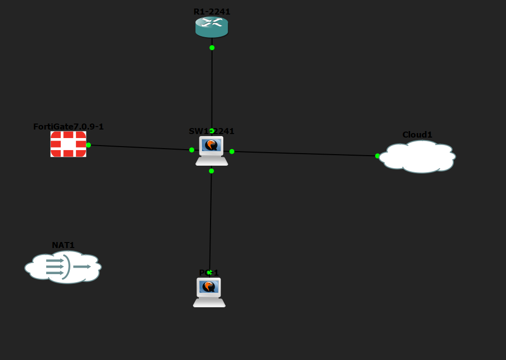

### Conexiones físicas

| Origen                        | Destino                                                     |
| ----------------------------- | ----------------------------------------------------------- |
| `R1-2241` FastEthernet0/0     | `SW1-2241` GigabitEthernet0/0                               |
| `SW1-2241` GigabitEthernet0/1 | Ubuntu auditor e0 (`ens3`)                                  |
| `SW1-2241` GigabitEthernet1/3 | `Cloud` eth0 (acceso desde la PC de administración)         |

Conectividad del Ubuntu auditor con los equipos:

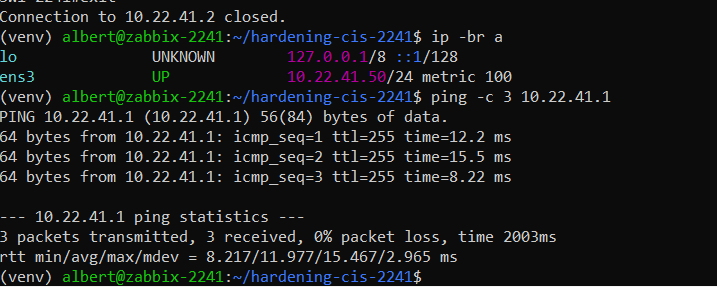

### Diagrama lógico

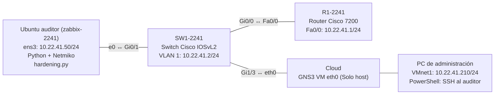

### Diagrama del flujo del script

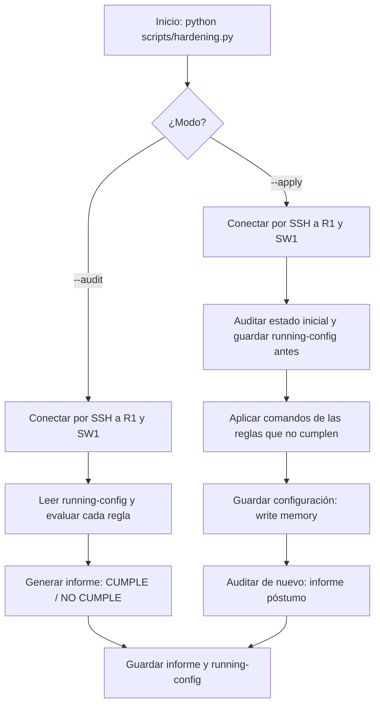

### Diagrama de interacción durante `--apply`

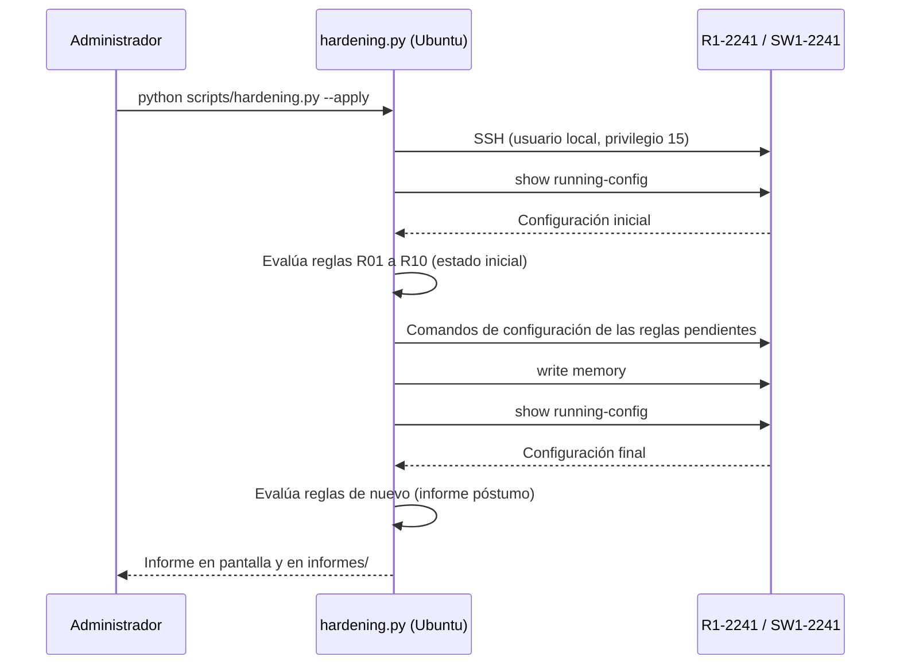

---

## 🔒 Recomendaciones CIS Aplicadas

El script revisa estas recomendaciones. Las dos últimas (R09 y R10) solo aplican al router, porque son funciones de capa 3.

| ID  | Recomendación                                   | Comando que se aplica                                 | Equipos      | Por qué se aplicó                                                                                                         |
| --- | ----------------------------------------------- | ----------------------------------------------------- | ------------ | ------------------------------------------------------------------------------------------------------------------------- |
| R01 | Contraseña de modo privilegiado con hash        | `enable secret <contraseña-enable>`                   | Router y SW  | Protege el modo privilegiado con un hash, no con una contraseña legible en la configuración.                              |
| R02 | Cifrado de contraseñas en la configuración      | `service password-encryption`                         | Router y SW  | Evita que las contraseñas de las líneas queden en texto claro al ver o respaldar la configuración.                        |
| R03 | Solo SSH en las líneas vty                      | `transport input ssh`                                 | Router y SW  | Telnet envía las credenciales en texto plano; SSH las cifra.                                                              |
| R04 | Cierre de sesiones inactivas                    | `exec-timeout 5 0` en `line con 0` y `line vty`       | Router y SW  | Una sesión administrativa abandonada es un acceso abierto; a los 5 minutos de inactividad se cierra.                      |
| R05 | Banner de aviso legal                           | `banner login # <texto> #`                            | Router y SW  | Advierte que el acceso es solo para personal autorizado y que la actividad se registra.                                   |
| R06 | Servidor HTTP/HTTPS deshabilitado               | `no ip http server` y `no ip http secure-server`      | Router y SW  | Un servicio web de administración innecesario es superficie de ataque adicional.                                          |
| R07 | Servicio PAD deshabilitado                      | `no service pad`                                      | Router y SW  | PAD es un servicio heredado que no se usa y no debe estar expuesto.                                                       |
| R08 | Marcas de tiempo en logs y depuración           | `service timestamps log datetime msec` y `debug`      | Router y SW  | Sin hora exacta no se pueden correlacionar eventos durante una investigación.                                             |
| R09 | Enrutamiento por origen deshabilitado           | `no ip source-route`                                  | Router       | Impide que el emisor dicte la ruta del paquete, técnica usada para evadir controles.                                      |
| R10 | Proxy ARP deshabilitado en interfaces con IP    | `no ip proxy-arp`                                     | Router       | Evita que el router responda ARP en nombre de otros hosts, lo que facilita la suplantación y expone la topología.         |

**Notas:**

- **Tipo de hash:** en este IOS (15.2) la regla R01 deja el `enable secret` como tipo 5 (MD5 con sal). Versiones más nuevas de IOS permiten tipo 9 (scrypt), que es más fuerte.
- **Algoritmos SSH antiguos:** el IOS emulado solo ofrece intercambio de claves con SHA-1, que las versiones nuevas de Paramiko (5.x) ya no incluyen. Por eso el proyecto fija **Paramiko 3.5.1** en [`requirements.txt`](requirements.txt). En equipos reales y actualizados esto no sería necesario.

---

## 🔬 Funcionamiento del Script

`scripts/hardening.py` se ejecuta desde el Ubuntu auditor, que tiene conectividad SSH con `R1-2241` y `SW1-2241`. Usa Netmiko para entrar a cada equipo con un usuario local de privilegio 15 y revisa la `running-config` con expresiones regulares.

| Modo      | Qué hace                                                                                                              | Qué genera                                                                                  |
| --------- | --------------------------------------------------------------------------------------------------------------------- | ------------------------------------------------------------------------------------------- |
| `--audit` | **No cambia nada.** Evalúa cada regla y marca `CUMPLE` o `NO CUMPLE`.                                                 | Informe en `informes/informe_audit_<fecha>.txt` y copia de la configuración                 |
| `--apply` | Evalúa, aplica solo los comandos de las reglas que no cumplen, guarda con `write memory` y vuelve a evaluar.          | Informe póstumo en `informes/informe_apply_<fecha>.txt` y las configs `*_antes.cfg` y `*_despues.cfg` |

Cada informe incluye la **fecha y la hora** de la ejecución, el cumplimiento por equipo y, en el modo `--apply`, la lista exacta de comandos aplicados.

**Resultados obtenidos:**

| Equipo     | Cumplimiento antes | Cumplimiento después |
| ---------- | ------------------ | -------------------- |
| `R1-2241`  | 2/10 (20%)         | 10/10 (100%)         |
| `SW1-2241` | 2/8 (25%)          | 8/8 (100%)           |

---

## ✅ Validación de la Implementación

### Informes del script

**Prueba 1 — Auditoría inicial (antes):** el router cumple 2 de 10 reglas y el switch 2 de 8, sin aplicar ningún cambio.

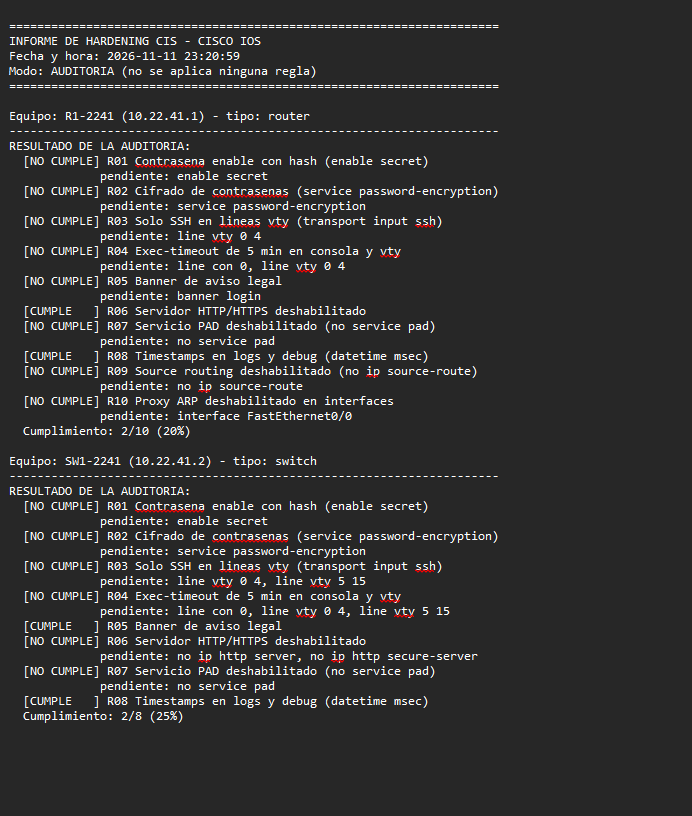

**Prueba 2 — Aplicación de reglas:** estado inicial, comandos aplicados y estado final de cada equipo.

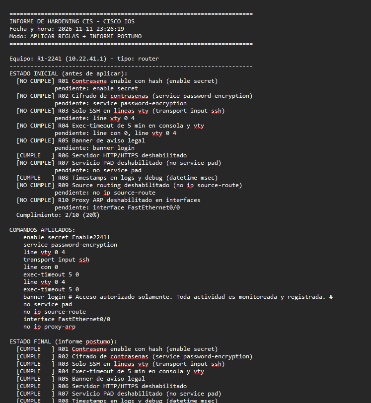

**Prueba 3 — Auditoría final (después):** una nueva auditoría confirma el 100% de cumplimiento en ambos equipos.

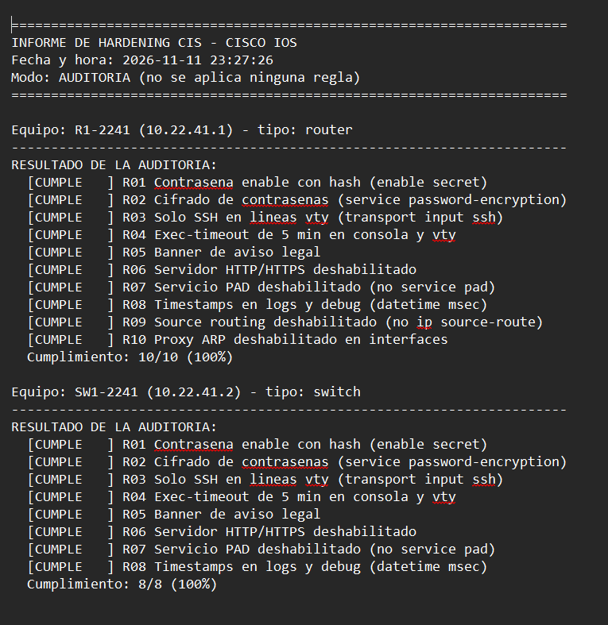

### Pruebas sobre la red

**Prueba 4 — Puertos cerrados y diferencias de configuración:** Telnet (23) y HTTP (80) rechazan la conexión, y `diff` muestra las líneas que cambiaron entre `*_antes.cfg` y `*_despues.cfg`.

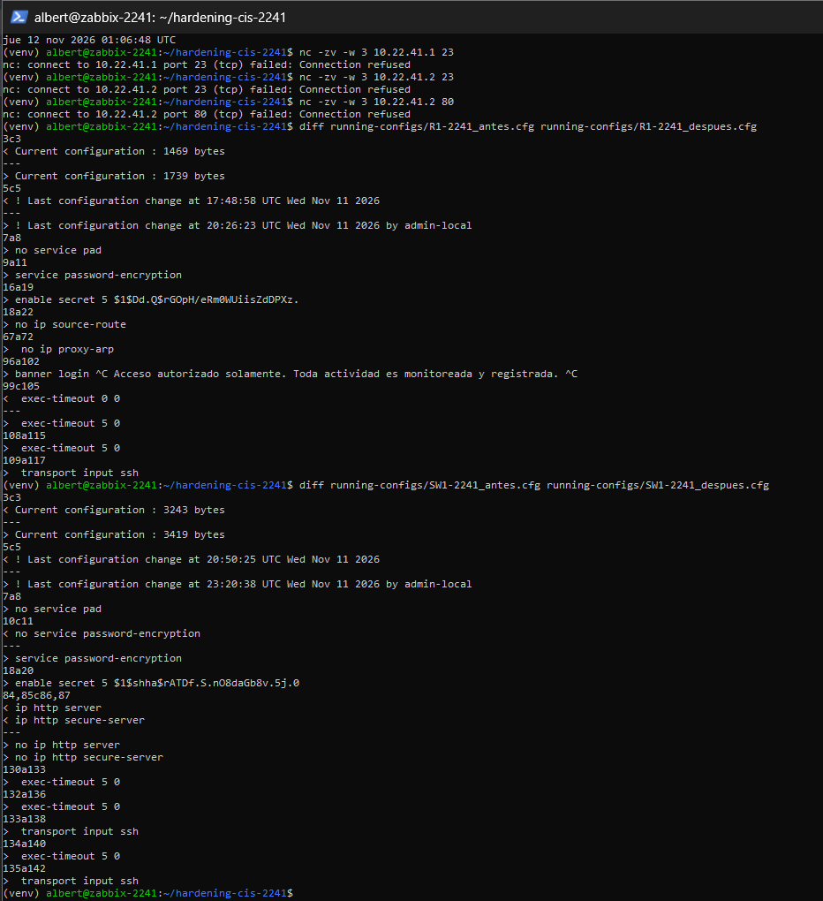

**Prueba 5 — Configuración final del router:** `enable secret`, cifrado de contraseñas, banner, líneas solo SSH, `exec-timeout` y `no ip proxy-arp`.

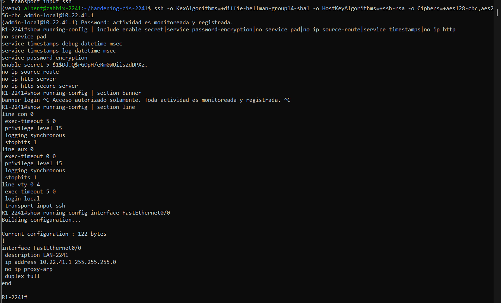

**Prueba 6 — Configuración final del switch:**

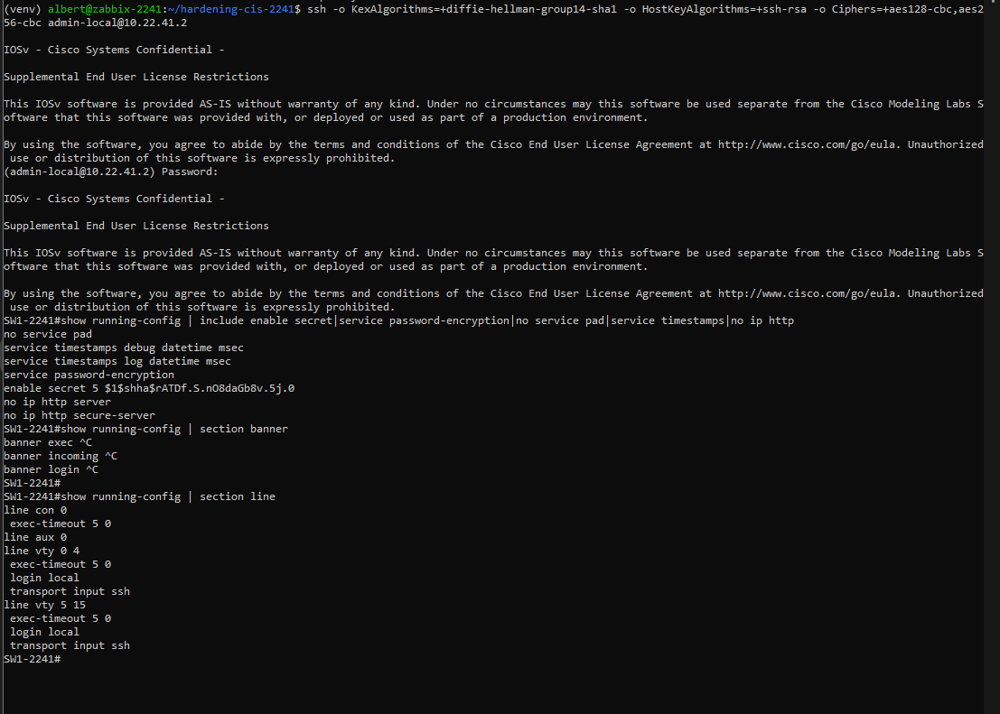

---

## 📜 Scripts

La carpeta [`scripts/`](scripts) contiene todo lo usado en el laboratorio. Las configuraciones de los equipos de red están en [`running-configs/`](running-configs).

| Script                                                                              | Dónde se ejecuta                                | Qué contiene                                                                    |
| ----------------------------------------------------------------------------------- | ----------------------------------------------- | ------------------------------------------------------------------------------- |
| [`01-R1-2241-ssh-base.txt`](scripts/01-R1-2241-ssh-base.txt)                         | Consola de `R1-2241`                            | Usuario local y SSH versión 2, base necesaria para que el script entre          |
| [`02-SW1-2241-ssh-base.txt`](scripts/02-SW1-2241-ssh-base.txt)                       | Consola de `SW1-2241`                           | Usuario local y SSH versión 2 en el switch                                      |
| [`03-ubuntu-auditor-instalacion.txt`](scripts/03-ubuntu-auditor-instalacion.txt)     | Consola del Ubuntu auditor                      | Python, entorno virtual y librerías                                             |
| [`04-ejecucion-y-pruebas.txt`](scripts/04-ejecucion-y-pruebas.txt)                   | Ubuntu auditor, consolas de R1 y SW1            | Ejecución del script, pruebas de puertos, `diff` y comandos `show`              |
| [`conexion.py`](scripts/conexion.py)                                                 | Ubuntu auditor (módulo importado)               | Conexión SSH con Netmiko a los equipos                                          |
| [`hardening.py`](scripts/hardening.py)                                               | Ubuntu auditor                                  | Auditoría y aplicación de las reglas CIS, con informes                          |

**Uso:**

```bash
pip install -r requirements.txt
python scripts/hardening.py --audit   # informe sin aplicar reglas
python scripts/hardening.py --apply   # aplica reglas e informe póstumo
```

> Las contraseñas del laboratorio se reemplazaron por marcadores como `<contraseña-del-laboratorio>`. Para ejecutar el script hay que sustituirlos por los valores reales.

---

## 📁 Estructura del Repositorio

```
README.md
requirements.txt
image/
├── 01-topologia-gns3.png
├── 02-ubuntu-red.png
├── 03-informe-audit-antes.png
├── 04-informe-apply.png
├── 05-informe-audit-despues.png
├── 06-pruebas-puertos-diff.png
├── 07-show-router.png
└── 08-show-switch.png

informes/
├── informe_audit_20261111_232059.txt
├── informe_apply_20261111_232619.txt
└── informe_audit_20261111_232726.txt

running-configs/
├── R1-2241_antes.cfg
├── R1-2241_despues.cfg
├── SW1-2241_antes.cfg
└── SW1-2241_despues.cfg

scripts/
├── 01-R1-2241-ssh-base.txt
├── 02-SW1-2241-ssh-base.txt
├── 03-ubuntu-auditor-instalacion.txt
├── 04-ejecucion-y-pruebas.txt
├── conexion.py
└── hardening.py
```
